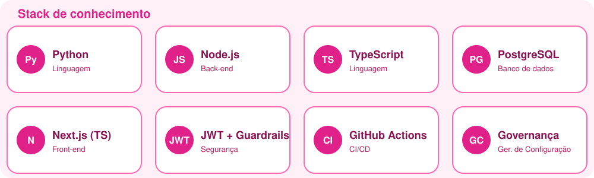

  

  
  
  

  

## 💖 Sobre mim

<table>
  <tr>
    <td>🎓 <b>Formação</b></td>
    <td>Engenharia de Software · Fametro</td>
  </tr>
  <tr>
    <td>💻 <b>Foco</b></td>
    <td>Back-end, banco de dados, segurança e governança de software</td>
  </tr>
  <tr>
    <td>🚀 <b>Projeto atual</b></td>
    <td><a href="https://github.com/witoriapaulino/DeskFlow">DeskFlow</a>, Central de Serviços de TI</td>
  </tr>
</table>

## 🌸 Stack de conhecimento

  

  
  
  
  
  
  
  
  

<b>💗 Clique para ver como uso cada tecnologia</b>

 

| | Tecnologia | No meu dia a dia |
| :-: | --- | --- |
| 🐍 | **Python** | Scripts, automação e análise de dados |
| 🟩 | **Node.js + TypeScript** | APIs tipadas no back-end |
| ▲ | **Next.js (TypeScript)** | Interfaces web com renderização no servidor |
| 🐘 | **PostgreSQL** | Modelagem relacional e migrações versionadas |
| 🔐 | **JWT + Guardrails** | Autenticação por token, perfis de acesso e regras de proteção |
| ⚙️ | **GitHub Actions** | Build e testes automáticos a cada push e pull request |
| 📋 | **Governança** | Versionamento, controle de mudanças e rastreabilidade |

## 🚀 Projeto em destaque

  

<b>🎀 Clique para ver como o DeskFlow é organizado</b>

 

- 📄 **Requisitos:** ERS, matriz de rastreabilidade (RTM) e inventário de itens de configuração.
- 🧩 **Código:** API com módulos de chamados, base de conhecimento, relatórios e autenticação.
- ✅ **Qualidade:** testes unitários, de integração e E2E rodando na CI.
- 🏷️ **Governança:** baselines por tag, Status Accounting e formulários de controle de mudanças.

➡️ [Abrir o repositório](https://github.com/witoriapaulino/DeskFlow)

  

